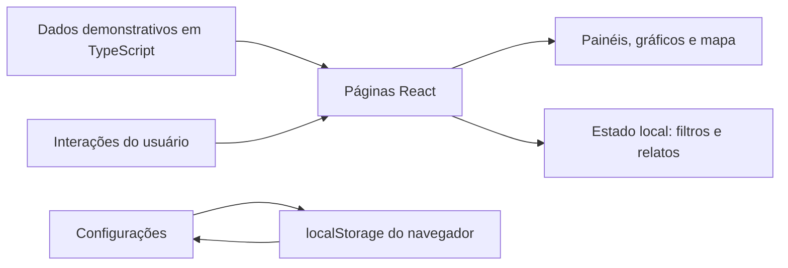

<div align="center">

# 💧 AquaMonitor

### Informação ambiental para uma cidade mais preparada.

Dashboard de monitoramento de níveis de água, alertas e ocorrências urbanas em **Juazeiro do Norte, Ceará**.


[Sobre](#-sobre-o-projeto) · [Funcionalidades](#-funcionalidades) · [Executar](#-como-executar) · [Arquitetura](#-arquitetura) · [Roadmap](#-próximos-passos)

</div>

---

## 🌎 Sobre o projeto

O **AquaMonitor** é uma aplicação web que apresenta uma proposta de acompanhamento de alagamentos urbanos. Ela reúne níveis de água, localização de pontos monitorados, alertas, histórico e relatos da comunidade em uma interface acessível pelo computador ou celular.

A ideia é transformar informações dispersas em uma visão compreensível: **onde a água está subindo, quais locais exigem atenção e como a situação evoluiu**. O cenário demonstrativo utiliza ruas e avenidas de Juazeiro do Norte, no Ceará.

O projeto tem caráter acadêmico e serve como exercício de desenvolvimento de software aplicado a um problema local. A implementação atual permite explorar a experiência de uso e a organização da aplicação antes da integração com sensores e serviços reais.

> **Estado atual:** protótipo interativo com dados demonstrativos. As telas não recebem telemetria real; mapas e trajetos são ilustrativos. A estrutura inicial de integração com Supabase existe, mas autenticação, banco de dados e atualização em tempo real ainda não estão conectados às páginas.

## 🎯 Problema e proposta

Durante períodos de chuva, entender a situação de diferentes vias pode exigir a consulta a várias fontes. Uma plataforma que reúna informações por local pode facilitar a leitura do cenário e o acompanhamento de mudanças.

O AquaMonitor explora essa proposta por três caminhos:

- **Visão centralizada:** apresentar pontos monitorados, níveis e estados de atenção em um único painel.
- **Contexto geográfico e temporal:** relacionar os dados à localização e à evolução dos eventos.
- **Participação da comunidade:** oferecer uma interface para registrar situações observadas nas ruas.

O público pensado para uma futura versão inclui moradores, equipes de monitoramento e gestores municipais. Nesta etapa, o objetivo é demonstrar o fluxo de uso e a base técnica para essa evolução.

## ✨ Funcionalidades

| Módulo | O que é possível explorar | Rota |
| --- | --- | --- |
| **Visão geral** | Indicadores de resumo, tabela de pontos, tendências, detalhes em modal e gráfico com seleção de ponto e períodos de 24h ou 7 dias. | `/` |
| **Simulação** | Circuito SVG, motor hidráulico, chuva, drenagem automática, reúso, proteções e eventos compartilhados com a Visão geral. | `/simulacao` |
| **Mapa** | Marcadores selecionáveis, busca por nome, filtros de status, zoom e detalhes do ponto selecionado. | `/mapa` |
| **Alertas** | Filtros de avisos ativos e resolvidos, níveis demonstrativos, linha do tempo, mapa ampliado e exibição de trajeto ilustrativo. | `/alertas` |
| **Ocorrências** | Busca por local ou bairro, filtros por situação, ordenação, galeria de imagens e formulário de relato. | `/ocorrencias` |
| **Histórico** | Consulta de eventos por ponto, alternância entre eventos e níveis, gráficos e detalhes dos incidentes. | `/historico` |
| **Configurações** | Preferências de avisos, pontos acompanhados, horário, opções de mapa e privacidade, além de limites ilustrativos de alerta. | `/configuracoes` |

A navegação se adapta a telas menores, com cabeçalho e menu próprios para dispositivos móveis. A interface também utiliza textos alternativos, rótulos acessíveis e estados de seleção em diversos controles.

### Pontos do cenário demonstrativo

| Local | Nível no painel inicial | Situação | Tendência |
| --- | --- | --- | --- |
| Avenida Leão Sampaio | 62 cm | Atenção | Subindo |
| Avenida Plácido Aderaldo Castelo | 38 cm | Normal | Descendo |
| Avenida Padre Cícero | 21 cm | Normal | Estável |

Esses valores são exemplos definidos no código. Alertas e histórico apresentam outros cenários demonstrativos, sem sincronização entre todas as telas.

### Como os dados se comportam hoje

- **Leituras, gráficos e eventos:** vêm de estruturas locais em TypeScript, sem consulta a sensores ou banco remoto.
- **Novas ocorrências:** são adicionadas ao estado da página e se perdem ao sair dela ou recarregar a aplicação. Não há envio a uma equipe externa.
- **Preferências:** ficam salvas no `localStorage` do navegador, na chave `aquamonitor-settings`. Sua gravação não ativa notificações, geolocalização ou regras reais de monitoramento.
- **Histórico:** a seleção de ponto filtra os eventos; os controles de período ainda não fazem uma consulta temporal real.
- **Atualização:** os botões de atualização em alertas e histórico alteram o horário exibido, sem buscar novas leituras.
- **Limites:** existem valores ilustrativos diferentes entre as telas. A unificação das regras faz parte da evolução prevista.

## 🛠️ Tecnologias

| Tecnologia | Papel no projeto |
| --- | --- |
| **React 19** | Componentes da interface e gerenciamento de estado das interações. |
| **TypeScript 5.9** | Tipagem de pontos, ocorrências, eventos e configurações. |
| **Vite 7** | Servidor de desenvolvimento e geração do build. |
| **React Router 7** | Navegação entre as páginas e seleção de pontos pela URL. |
| **CSS** | Estilos globais, identidade visual e layouts responsivos por módulo. |
| **Lucide React** | Ícones utilizados na navegação e nos indicadores. |
| **Supabase JS** | Base de integração para o backend futuro; ainda sem uso nas telas. |
| **ESLint** | Verificação estática do código. |

Os gráficos são desenhados com **SVG**, e o mapa utiliza uma imagem local com marcadores sobrepostos.

## 🚀 Como executar

### Pré-requisitos

- **Node.js 20.19+ na linha 20, ou 22.12+**, conforme o requisito do Vite instalado.
- **npm** e **Git** disponíveis no terminal.

### 1. Clone e instale

```bash
git clone https://github.com/mateussba/AquaMonitor.git
cd AquaMonitor
npm ci
```

### 2. Inicie o ambiente de desenvolvimento

```bash
npm run dev
```

Abra o endereço apresentado no terminal pelo Vite, normalmente `http://localhost:5173`.

**O protótipo pode ser explorado sem configurar Supabase.** As páginas atuais utilizam dados locais e não chamam o cliente do serviço.

### 3. Configuração opcional de Supabase

Para preparar as variáveis utilizadas pela integração futura, crie um arquivo `.env.local` na raiz com os seguintes campos:

```dotenv
VITE_SUPABASE_URL=https://seu-projeto.supabase.co
VITE_SUPABASE_PUBLISHABLE_KEY=sua-chave-publishable
```

O arquivo `.env.example` existe, mas está vazio nesta versão. Preencher essas variáveis, por si só, não conecta as páginas ao banco: ainda será necessário implementar o modelo de dados e as operações da aplicação.

Use a chave **publishable** no frontend. Chaves secretas e `service_role` devem ficar fora do navegador. Consulte a [documentação oficial de chaves do Supabase](https://supabase.com/docs/guides/getting-started/api-keys). O `.env.local` já está incluído no `.gitignore`.

### Comandos disponíveis

| Comando | Resultado |
| --- | --- |
| `npm run dev` | Inicia o servidor de desenvolvimento. |
| `npm run build` | Verifica os tipos com TypeScript e gera o build em `dist/`. |
| `npm run preview` | Serve o build localmente para conferência. |
| `npm run lint` | Executa as verificações do ESLint. |

Para conferir a versão de produção localmente:

```bash
npm run build
npm run preview
```

## 🧩 Arquitetura

A aplicação está organizada por funcionalidades. Cada domínio concentra suas páginas e, quando necessário, seus dados demonstrativos. Componentes compartilhados e integrações ficam em diretórios próprios.

```text
AquaMonitor/
├── src/
│   ├── assets/                  # Mapa e imagens das ocorrências
│   ├── components/
│   │   ├── layout/AppShell.tsx   # Navegação e estrutura compartilhada
│   │   └── ui/MetricCard.tsx     # Cartão reutilizável de indicador
│   ├── features/
│   │   ├── dashboard/           # Visão geral e pontos demonstrativos
│   │   ├── map/                 # Mapa e seleção de pontos
│   │   ├── alerts/              # Alertas e detalhes dos incidentes
│   │   ├── occurrences/         # Relatos da comunidade
│   │   ├── history/             # Eventos anteriores e gráficos
│   │   └── settings/            # Preferências locais
│   ├── lib/supabase.ts          # Função para criar o cliente Supabase
│   ├── styles/                  # CSS global e por página
│   ├── types/database.ts        # Tipos iniciais do banco, ainda sem tabelas
│   ├── App.tsx                  # Definição das rotas
│   └── main.tsx                 # Inicialização da aplicação
├── supabase/README.md           # Orientações iniciais para o backend
├── package.json                # Dependências e scripts
└── vite.config.ts              # Configuração do Vite e alias @/
```

### Fluxo da versão atual



O `AppShell` mantém a navegação compartilhada, enquanto o React Router troca a página exibida. Os parâmetros `?ponto=` permitem abrir um ponto específico no mapa ou selecionar um alerta relacionado.

## 🎓 Aprendizados e decisões técnicas

O projeto permite praticar conceitos de desenvolvimento web em um cenário concreto:

- **Componentização:** reaproveitar a estrutura de navegação e cartões de indicadores.
- **Modelagem com tipos:** representar níveis, tendências, status e eventos de forma explícita.
- **Estado e interação:** implementar busca, filtros, seleção, formulários e modais com hooks do React.
- **Roteamento:** conectar a visão geral aos detalhes e compartilhar a seleção de pontos pela URL.
- **Persistência local:** salvar preferências entre sessões do navegador.
- **Visualização de dados:** construir gráficos SVG e representar estados com cores, textos e ícones.
- **Organização por domínio:** facilitar a localização do código e a evolução de cada módulo.

A escolha de dados demonstrativos permite desenvolver e avaliar os fluxos da interface antes da disponibilidade de sensores. A estrutura de integração com Supabase prepara um ponto de partida para a próxima etapa.

## 🗺️ Próximos passos

- [x] Construir as seis páginas e a navegação responsiva.
- [x] Implementar busca, filtros, detalhes e visualizações demonstrativas.
- [x] Criar o formulário local de ocorrências.
- [x] Persistir preferências no navegador.
- [x] Adicionar a estrutura inicial do cliente Supabase.
- [ ] Unificar os limites e a classificação de risco entre os módulos.
- [ ] Criar tabelas e migrations para pontos, leituras, alertas e ocorrências.
- [ ] Implementar autenticação e políticas de acesso ao banco.
- [ ] Persistir relatos e permitir upload de imagens.
- [ ] Conectar sensores e receber leituras reais.
- [ ] Integrar atualização em tempo real e notificações.
- [ ] Implementar consultas de histórico por intervalo de datas.
- [ ] Integrar mapas geográficos e validar a proposta de rotas.
- [ ] Ampliar a verificação de acessibilidade e adicionar testes dos fluxos principais.

## 🧪 Roteiro de demonstração

1. Abra a **Visão geral**, selecione um ponto no gráfico e alterne entre os períodos.
2. Clique em **Ver no mapa**, selecione marcadores e experimente a busca e os filtros.
3. Explore **Alertas**, compare avisos ativos e resolvidos e consulte a linha do tempo.
4. Em **Ocorrências**, registre um relato e observe sua inclusão na lista local.
5. Consulte **Histórico**, filtre por ponto e alterne entre eventos e níveis.
6. Altere uma preferência em **Configurações** e recarregue a página para verificar sua persistência.

## 🤝 Contribuições

Sugestões e melhorias podem ser apresentadas nas [issues do repositório](https://github.com/mateussba/AquaMonitor/issues). Para contribuir com código, descreva o problema, mantenha a organização por funcionalidades e execute `npm run lint` e `npm run build` antes de abrir um pull request.

## 🌐 English overview

**AquaMonitor** is an academic web prototype for exploring urban flood monitoring in Juazeiro do Norte, Brazil. It combines water-level dashboards, an illustrative map, alerts, community reports, historical events, and user preferences in a responsive React and TypeScript application.

The current version uses local demonstration data. Reports are held in page state, preferences are stored in the browser, and the initial Supabase integration is not yet connected to the UI. Future work includes real sensor readings, database persistence, authentication, and live updates.

To run locally, clone the repository, run `npm ci`, then `npm run dev`. No Supabase credentials are required to explore the current prototype.


## Simulação hidráulica — primeira etapa

A rota `/simulacao` e o cartão **Monitoramento virtual** da Visão geral compartilham uma estação de demonstração, independente dos três pontos urbanos. A implementação não adiciona dependências e funciona localmente sem serviços externos. A fonte Google Fonts já existente é opcional: o navegador utiliza fontes de sistema offline.

### Organização e decisões

- `src/features/simulation/engine/simulation.ts`: tipos, configuração centralizada, seletores, reducer puro e balanço volumétrico. Nenhuma dependência de React, relógio ou rede.
- `components/SimulationProvider.tsx` e `hooks/SimulationContext.ts`: estado compartilhado acima do `AppShell` e das rotas, um único intervalo com limpeza em pausa/desmontagem, delta medido com `performance.now()`.
- `components/HydraulicScene.tsx`: desenho SVG e animações condicionadas aos estados do motor; pausa congela as animações e a preferência por movimento reduzido é respeitada.
- `components/VirtualMonitoring.tsx`: acompanha nível, drenagem, reservatório, risco e último evento no dashboard.
- `pages/SimulationPage.tsx` e `styles/simulation.css`: controles acessíveis, métricas, alarmes, eventos e explicação do modelo. No celular, o circuito permite rolagem horizontal para preservar a legibilidade técnica.
- `tests/simulation.test.mjs`: testes determinísticos com o executor nativo do Node, sem biblioteca adicional.

### Parâmetros didáticos

| Parâmetro | Valor |
| --- | --- |
| Galeria prismática | Base 0,1 m²; 1 litro/cm; máximo 30 cm = 30 L |
| Estado inicial | Galeria 8 L; reservatório 5 L; capacidade 40 L; chuva zero; pausada |
| Capacidade configurável | 5–200 L |
| Chuva efetiva de 100% | 3 L/min; controle linear de 0–100% |
| Drenagem nominal | 2 L/min; liga ≥20 cm, desliga ≤12 cm |
| Reúso nominal | 1,2 L/min, condicionado à solicitação e água disponível |
| Risco da estação | Normal <18 cm; atenção ≥18 cm; crítico ≥26 cm |
| Tempo | 1×, 10×, 30× (inicial), 60× ou 120× |
| Integração | Passo fixo de 0,25 segundo simulado com resíduo entre atualizações |

O filtro é ideal, sem perdas e sem atraso. O motor limita as transferências pela disponibilidade da origem e capacidade do destino, contabiliza excesso e nunca permite volumes negativos ou acima das capacidades. Pequenas diferenças de até um passo podem ocorrer nos instantes de cruzamento de limites.

A identidade de conservação é:

```text
volume da galeria + volume do reservatório
= 13 L iniciais + chuva acumulada + aporte externo de teste
  - reúso acumulado - transbordamento acumulado
```

O botão de reservatório cheio injeta um aporte externo contabilizado; reduzir a capacidade contabiliza o excesso como transbordamento. Falha de sensor e destino cheio bloqueiam a drenagem imediatamente, mesmo em pausa. A solicitação de reúso permanece ativa até cancelamento; a bomba bloqueia no vazio e pode retomar quando houver água. Estados de bomba representam a decisão do controlador; em pausa, não há transferência e as vazões exibidas são zero.

### Executar e validar

```bash
npm ci
npm run dev
# abrir http://localhost:5173/simulacao
npm test
npm run build
npm run lint
```

Para `npm test`, utilize Node 22.18+ ou Node 24+, com suporte nativo a TypeScript. A validação desta entrega foi feita no Node 24.21.0.

Os 11 testes automatizados cobrem A–H e J: chuva desligada, elevação por tempestade, acionamento a 20 cm, histerese e desligamento a 12 cm, destino cheio, reúso, vazio, falha do sensor e reinicialização. Também verificam balanço com excesso e aporte externo, redução de capacidade, pausa/continuidade, validação de controles e independência da frequência dos ticks.

O cenário I foi verificado no navegador: após iniciar tempestade, pausar e alternar `/simulacao` → `/` → `/simulacao`, os valores foram preservados; após continuar, o nível subiu diretamente no cartão da Visão geral. Também foram inspecionados layouts em 1440×1000 e 390×844 e a entrada de Simulação no menu móvel. Build e lint passaram. A verificação no navegador é manual, não uma suíte E2E versionada.

Roteiro rápido: iniciar, simular tempestade e aguardar 20 cm; parar chuva para observar o desligamento a 12 cm; solicitar reúso; preencher o reservatório para testar bloqueio; ativar/desativar falha do sensor; navegar para a Visão geral; reiniciar. Com velocidade de 30×, a tempestade leva aproximadamente 8 segundos reais para sair de 8 cm e chegar a 20 cm.

### Integração ESP32 Wokwi / EMQX Cloud

A integração atual está descrita em [docs/INTEGRACAO-EMQX.md](docs/INTEGRACAO-EMQX.md), incluindo arquitetura, segurança das credenciais temporárias, arquivos alterados, testes locais e roteiro de validação no broker real.

Use `npm run dev` nesta pasta e abra `/simulacao`. A maquete integrada é construída pelo `predev` e servida em `/prototype/`. Após alterar os fontes do protótipo enquanto o Vite principal estiver aberto, execute `npm --prefix prototype-3d run build` para atualizar os arquivos servidos.

### Notificações da estação

O sino, os avisos na tela e “Alertas recentes” acompanham mudanças de nível, bombas, alarmes e telemetria. O histórico da sessão fica disponível em Alertas, com marcação como lida e identificação da origem ESP32/Wokwi ou simulação local. Consulte [docs/NOTIFICACOES.md](docs/NOTIFICACOES.md) para o roteiro de teste e os arquivos alterados.

## Dashboard conciso e banco preparado

A visão geral foi reorganizada com resumo, seleção de pontos, prioridade, evolução e acesso ao laboratório. Para ativar o Supabase posteriormente, siga [o guia de conexão](docs/database.md). O esquema inicial fica em `supabase/schema.sql`; sem credenciais, o painel indica modo demonstração.
